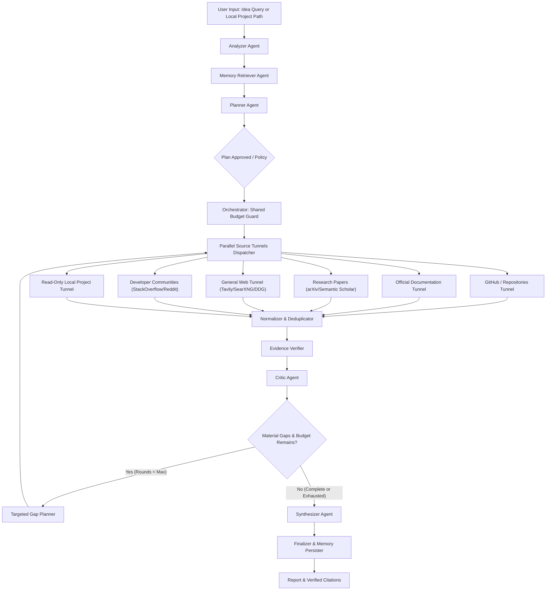

# RAVEN Agent Architecture & Specification

RAVEN is a multi-agent Project Intelligence & Research Agent operating on LangGraph. This document outlines the role, schema contracts, and behavior of every agent node in the workflow.

---

## Agent Specifications

### 1. Analyzer Agent (`src/agents/analyzer.py`)
- **Responsibility:** Classifies user input into either an `idea` (product idea, comparison, architecture question) or an existing `project` (local project path).
- **Security:** If a project path is submitted, enforces read-only traversal guards (`safe_resolve_path`), preventing directory escape.
- **Output:** `AnalyzerOutput` with goals, constraints, assumptions, and extracted project metadata.

### 2. Memory Retriever Agent (`src/memory/layered_memory.py`)
- **Responsibility:** Queries the 6-layer memory subsystem for episodic memory, past approved decisions, user preferences, and valid evidence cache entries with TTL.
- **Safety:** Old evidence is treated as a lead, not definitive truth. Never returns credentials or instructions.

### 3. Planner Agent (`src/agents/planner.py`)
- **Responsibility:** Generates explicit research objectives, research questions, acceptance criteria, source tunnel assignments, and freshness requirements.
- **Output:** `ResearchPlan` (Pydantic model) containing structured `ResearchObjective` elements.

### 4. Source Tunnels Dispatcher (`src/tunnels/dispatcher.py`)
Runs 6 parallel, isolated tunnel connectors:
1. **GitHub Tunnel (`github_tunnel.py`):** Deep repository inspection extracting stars, forks, licenses, open issues, commit activity, latest release tags/dates, and parsed README architecture sections.
2. **Official Documentation Tunnel (`docs_tunnel.py`):** Queries official frameworks, language docs, and API documentation.
3. **Research Papers Tunnel (`papers_tunnel.py`):** Queries arXiv, CrossRef, and OpenAlex.
4. **General Web Tunnel (`web_tunnel.py`):** Search candidates via Tavily / DuckDuckGo, deeply inspected using `BrowserInspector` (HTTP + Playwright fallback with SSRF guards).
5. **Developer Communities Tunnel (`community_tunnel.py`):** Stack Overflow and Reddit discussions.
6. **Local Project Tunnel (`local_project_tunnel.py`):** Read-only inspection of repository structure, dependencies (`requirements.txt`, `package.json`, `Cargo.toml`), and code statistics.
- **Resilience:** If any tunnel connector is missing credentials or fails, it reports `disabled` or `failed` with a descriptive reason without crashing other tunnels.

### 5. Normalizer & Deduplicator (`src/tunnels/normalizer.py`)
- **Responsibility:** Strips tracking parameters, canonicalizes URLs, computes SHA-256 content hashes, and deduplicates evidence items deterministically.
- **Output:** Unique list of `EvidenceItem` with stable IDs (`ev_...`).

### 6. Evidence Verifier (`src/tunnels/verifier.py`)
- **Responsibility:** Evaluates source reachability, excerpt relevance, provenance, and computes deterministic freshness states (`fresh`, `aging`, `stale`, `unknown`) based on timestamps and release metadata.
- **Rule:** LLMs are never permitted to guess whether a date is fresh. Search snippets alone are flagged as weak proof for high-impact claims.

### 7. Critic Agent (`src/agents/critic.py`)
- **Responsibility:** Evaluates evidence coverage against the research plan objectives, identifies contradictory claims, flags unsupported assumptions, and computes a `coverage_score` (0–100).
- **Decision:** Determines whether to `continue` to targeted research or `stop` if the budget is depleted or coverage is sufficient.
- **Output:** `CritiqueReport` with structured gap descriptions.

### 8. Targeted Gap Planner (`src/agents/critic.py`)
- **Responsibility:** Formulates targeted, narrow search queries specifically addressing unresolved gaps identified by the Critic.
- **Rule:** Never modifies or inflates the originally approved research scope.

### 9. Synthesizer Agent (`src/agents/synthesizer.py`)
- **Responsibility:** Compiles the evidence ledger into an evidence-grounded report with a repository comparison table and 9-field resource evidence cards.
- **Structure:**
  - Executive Summary
  - Architectural & Empirical Findings
  - Sourced Facts vs. Inferences
  - Strategic Recommendations
  - Unknowns & Limitations
  - Repository Comparison Table (Language, Stars, License, Latest Push, Suitability)
  - Inspected Resources Cards (What it is, provides, technical details, excerpts, freshness, recommendation, limitations)
- **Citation Rule:** Synthesizes strictly from verified evidence. Every citation `[S#]` must resolve to an entry in the evidence ledger.

### 10. Finalizer & Memory Persister (`src/agents/raven_graph.py`)
- **Responsibility:** Verifies citation integrity, writes safe run summaries to episodic memory, updates preference memory, and persists the completed run ledger.

### 11. Evaluator & LangSmith Engine (`src/evaluation/evaluator.py`)
- **Responsibility:** Computes 10 objective quality metrics (coverage, citation validity, citation support, relevance, source diversity, extraction success, freshness correctness, correction gain, cost, latency) across a fixed 8-query evaluation dataset, and streams sanitized evaluation metrics to LangSmith.

### 12. Cross-Run Learning Engine (`src/memory/learning.py`)
- **Responsibility:** Aggregates recurring run failures, drafts versioned improvement proposals, evaluates them against the baseline dataset, and records approved adjustments with rollback data. Arbitrary autonomous code rewrites are strictly prohibited.
