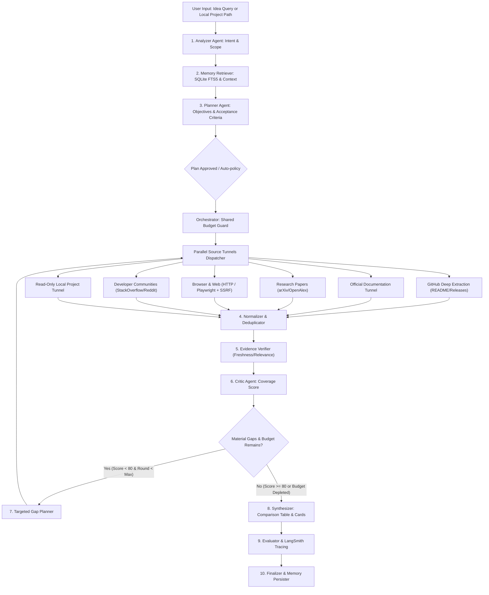

# RAVEN — Project Intelligence & Research Agent

<p align="left">


</p>

> **RAVEN** is a multi-agent Project Intelligence & Research Agent. It takes either an **idea/research query** or an **existing local codebase** (in read-only mode), plans research objectives, gathers multi-source evidence concurrently across 6 source tunnels, deeply inspects web pages and GitHub repositories (READMEs, releases, commit activity), verifies freshness and reachability, critiques coverage in an active gap-loop, evaluates run quality metrics with LangSmith tracing, and synthesizes evidence-grounded reports with verified citations.

---

## Table of Contents

1. [System Workflow](#1-system-workflow)
2. [Technology Stack](#2-technology-stack)
3. [Deep Resource Intelligence & Extraction](#3-deep-resource-intelligence--extraction)
4. [Layered Memory & Storage Architecture](#4-layered-memory--storage-architecture)
5. [Evaluation, LangSmith & Continuous Learning](#5-evaluation-langsmith--continuous-learning)
6. [API Specification & Endpoints](#6-api-specification--endpoints)
7. [Resilient Groq Key-Chaining](#7-resilient-groq-key-chaining)
8. [Installation & Setup](#8-installation--setup)
9. [Running the Application](#9-running-the-application)
10. [Running Tests](#10-running-tests)
11. [Architecture Documents](#11-architecture-documents)

---

## 1. System Workflow

RAVEN coordinates 10 agent and tunnel nodes on **LangGraph**. The workflow enforces a shared run budget and dynamic critique loop:



---

## 2. Technology Stack

| Layer | Technologies & Libraries | Responsibility |
|---|---|---|
| **Multi-Agent Orchestrator** | **LangGraph**, **LangChain Core** | State machine, fan-out, targeted gap loops, checkpoints |
| **Backend Framework** | **Python 3.11+**, **FastAPI**, **Uvicorn** | REST API endpoints, asynchronous SSE event streaming |
| **Data Validation** | **Pydantic v2** | Strict schema validation for all agent inter-communication |
| **LLM Provider Engine** | **Groq Multi-Key Adapter** | 5-key resilient failover, HTTP 429 backoff, 401/403 cooldown |
| **Browser Inspection** | **Playwright**, **aiohttp**, **BeautifulSoup4** | Safe HTTP fetching with headless browser fallback, SSRF guards |
| **Frontend Framework** | **React 19**, **Vite 7**, **TypeScript** | Responsive single-page application with dark technical editorial theme |
| **Diagrams & Flowcharts** | **Mermaid.js** | Live, event-driven workflow visualization reflecting backend state |
| **Styling & Animation** | **Tailwind CSS v4**, **Framer Motion 12** | Custom typography, micro-interactions, dark aesthetic |
| **Document Processing** | **PyMuPDF (Fitz)** | PDF extraction, academic paper segment parsing |
| **Search Connectors** | **Tavily**, **DuckDuckGo**, **GitHub API**, **arXiv API** | Multi-source discovery and candidate harvesting |
| **Persistence / Database** | **SQLite FTS5 + JSON Flat Files** | Fast BM25 full-text memory search, bounded content store |
| **Observability & Eval** | **LangSmith**, **RavenEvaluator** | 10 quality metrics, 8-query evaluation dataset, secret redaction |

---

## 3. Deep Resource Intelligence & Extraction

RAVEN does not stop at summarizing search snippets. Each discovered resource is inspected and unpacked into structured evidence:

### A. Deep GitHub Repository Extraction
- Queries the GitHub API and raw content endpoints for candidate repositories.
- Extracts: stars, forks, open issues, primary language, license (SPDX), and push/release dates.
- Fetches and parses **`README.md`** files, extracting architecture, features, and setup sections.
- Synthesizes a **Repository Comparison Table** in the final report comparing language, stars, license, latest activity, and architectural suitability.

### B. Browser & HTTP Inspection (`BrowserInspector`)
- **HTTP First:** Fast, lightweight HTML extraction using `aiohttp` and `BeautifulSoup4`.
- **Playwright Fallback:** Renders client-side JavaScript when a page requires browser execution.
- **SSRF Guards (`safe_validate_url`):**
  - Restricts schemes strictly to `http` and `https`.
  - Rejects private, loopback, link-local, and multicast IP ranges (`127.0.0.1`, `169.254.169.254`, `10.0.0.0/8`, `192.168.0.0/16`).
  - Resolves host DNS and validates resolved IPs against private network masks.
  - Enforces response size caps (5MB) and timeouts.

### C. 9-Field Resource Intelligence Cards
Every inspected resource provides 9 structured fields:
1. **What it is:** Concise description based on inspected text.
2. **What it provides:** Key capabilities, APIs, and features.
3. **Technical details:** Architecture, dependencies, stack, and versions.
4. **Evidence extracted:** Verifiable excerpts with character and line boundaries.
5. **Freshness & status:** Deterministic update age, retrieval timestamp, and verification status.
6. **Relevance to query:** Objective link and matching technical terms.
7. **Recommendation:** Actionable advice on whether to adopt, reuse, or avoid.
8. **Limitations:** Missing capabilities, licensing risks, and unresolved unknowns.
9. **Source link:** Canonical URL for verification.

---

## 4. Layered Memory & Storage Architecture

RAVEN combines **SQLite FTS5** for fast BM25 full-text matching with human-readable **JSON flat files** in the `storage/` directory:

```
storage/
├── content/                  # BoundedContentStore (50MB cap, raw page/README text)
│   └── {hash}.txt
├── memory/
│   ├── raven_memory.db       # SQLite FTS5 virtual tables (episodic_fts, cache_fts)
│   ├── episodic.json         # Compact summaries of completed runs
│   ├── project.json          # Tech stack profiles and constraints of inspected codebases
│   ├── decisions.json        # Architectural decisions explicitly approved by the user
│   ├── evidence_cache.json   # Reusable evidence items with TTL
│   ├── preferences.json      # User research preferences and report styles
│   ├── failures.json         # Recurring failure patterns
│   └── proposals.json        # Versioned improvement proposals
└── traces/
    └── {job_id}/
        ├── metadata.json     # Run metadata and completion status
        └── events.jsonl      # Chronological sequence of workflow events for live replay
```

---

## 5. Evaluation, LangSmith & Continuous Learning

### A. 10 Quality Metrics (`RavenEvaluator`)
1. **Objective Coverage:** Proportion of objectives with verified evidence.
2. **Citation Validity:** Proportion of citations resolving to gathered evidence.
3. **Citation Support:** Verified excerpt substance supporting claims.
4. **Resource Relevance:** Query and objective term overlap.
5. **Source Diversity:** Coverage across repositories, docs, papers, and web.
6. **Extraction Success:** Ratio of inspections yielding substantive content.
7. **Freshness Correctness:** Accurate ISO date parsing without LLM guessing.
8. **Correction Gain:** Measured coverage improvement from gap research passes.
9. **Cost & Latency:** Shared budget calls and duration consumed.
10. **Overall Score:** Weighted composite score (0–1.0).

### B. Fixed Evaluation Benchmark Dataset
Contains 8 realistic technical test cases:
- GitHub repository comparison (DuckDB vs SQLite)
- Framework documentation versions (LangGraph vs AutoGen)
- Academic paper analysis (Speculative decoding)
- Conflicting developer discussions (Node.js cluster vs worker threads)
- JavaScript-rendered sites (Next.js App Router Server Actions)
- Unreachable service handling (Fault tolerance)
- Memory reuse with stale evidence re-verification
- Gap loop triggering under missing evidence

### C. Cross-Run Continuous Learning (`CrossRunLearningEngine`)
- Aggregates recurring run failures (`storage/memory/failures.json`).
- Generates versioned behavioral improvement proposals (query formulation, source priorities, extraction thresholds).
- Tests proposals against the benchmark dataset and requires demonstrated score improvements before adoption.
- **Safety Rule:** Self-review proposes reviewable parameter changes; arbitrary code rewrites are strictly blocked.

---

## 6. API Specification & Endpoints

FastAPI server runs at `http://localhost:8000`:

- `POST /api/research` — Launch research job (`topic`, `depth`, `provider`, `model`, `project_path`).
- `GET /api/research/{job_id}/stream` — Server-Sent Events (SSE) live updates.
- `GET /runs/{job_id}/events` — Replay sequenced workflow events.
- `GET /health` — System status and Groq key slot availability.

---

## 7. Resilient Groq Key-Chaining

- **Up to 5 Key Slots:** `GROQ_API_KEY_1` to `GROQ_API_KEY_5`.
- **Rate-Limit Resilience:** Respects HTTP 429 `Retry-After` headers and rotates to next available key.
- **Key Health Tracking:** Automatic cooldown on HTTP 401/403 invalid keys.
- **Secret Redaction:** Strict regex scrubbing of all tokens from logs, traces, errors, and UI streams.
- **Run Budget:** Enforced `MAX_LLM_CALLS_PER_RUN` and time limits.

---

## 8. Installation & Setup

```bash
# 1. Clone repository
git clone https://github.com/royxforge/revan.git
cd revan

# 2. Set up virtual environment
python -m venv .venv
.\.venv\Scripts\activate   # Windows
# source .venv/bin/activate # Linux/macOS

# 3. Install backend dependencies
pip install -r requirements.txt
pip install pytest-asyncio beautifulsoup4 playwright

# 4. Configure environment
cp .env.example .env
# Edit .env with your GROQ_API_KEY_1..5

# 5. Install frontend dependencies
cd frontend
npm install
cd ..
```

---

## 9. Running the Application

### Start Backend
```bash
python run.py
# Runs at http://localhost:8000
```

### Start Frontend
```bash
cd frontend
npm run dev
# Runs at http://localhost:5173
```

---

## 10. Running Tests

```bash
# Run complete test suite (131 tests passing)
python -m pytest tests/ -v

# Run frontend build check
cd frontend
npm run build
```

---

## 11. Architecture Documents

- [DECISIONS.md](DECISIONS.md): Architecture Decision Records (ADR-0001 through ADR-0010).
- [AGENTS.md](AGENTS.md): Full agent node specifications and schema contracts.
- [LICENSE](LICENSE): MIT License (2026 Revan).