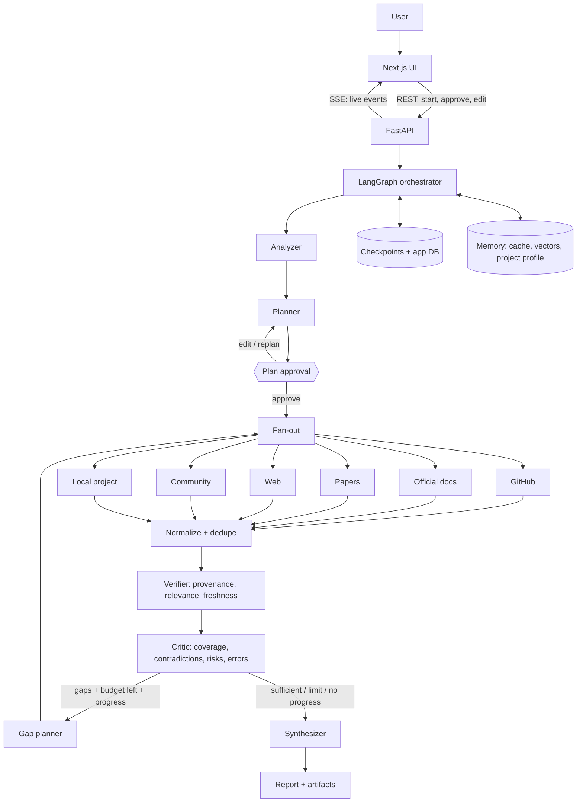

# ARCHITECTURE.md

## 1. System overview



## 2. Layers

| Layer | Responsibility | Must not |
|---|---|---|
| UI (Next.js) | Input, plan review, live flow, report | Hold the only copy of run state |
| API (FastAPI) | Start/approve/cancel runs, stream events, serve reports | Contain research logic |
| Orchestrator (LangGraph) | State, routing, fan-out, loop, budget, stop reasons | Call source APIs directly |
| Agents | One judgment job each (see AGENT_ROLES.md) | Control the loop |
| Tunnels | Fetch from one source type, return structured evidence | Start follow-up research |
| Project connector | Read-only, scoped file access | Execute or modify anything |
| LLM adapter | Provider-agnostic model calls, structured output, retries via budget | Leak provider details into agents |
| Persistence | Checkpoints, runs, evidence, cache, vectors | Store secrets |

## 3. Graph state

```python
class RavenState(TypedDict):
    run_id: str
    mode: Literal["idea", "project"]
    query: str
    project_root: str | None                 # set only by trusted local connector
    project_context: ProjectContext | None

    plan: ResearchPlan | None                # objectives + criteria
    plan_approved: bool
    round: int                               # 1-based research round

    tasks: list[TunnelTask]                  # current round's assignments
    evidence: Annotated[list[EvidenceRecord], merge_evidence]      # dedupe by key
    tunnel_status: Annotated[dict[str, TunnelStatus], merge_status]
    usage: Annotated[Usage, add_usage]       # additive counters (calls, retries)

    verification: VerificationReport | None
    critic: CriticReport | None              # coverage, gaps, contradictions, risks
    stop_reason: StopReason | None
    report: Report | None
```

### Reducers (mandatory)

Any field written by parallel tunnel nodes needs a reducer:

| Field | Merge rule |
|---|---|
| `evidence` | Append, then de-duplicate by `(source_url or file+lines, normalized excerpt hash)` |
| `tunnel_status` | Dict merge, latest timestamp wins per tunnel |
| `usage` | Additive (LLM calls, retries, tokens, requests per source) |

Test: run N tunnels concurrently, each emitting distinct evidence, and assert all N results survive.

## 4. Nodes

| Node | Type | Notes |
|---|---|---|
| `analyze` | LLM + deterministic | Project mode: inventory + summary. Idea mode: extract goal, constraints, assumptions |
| `plan` | LLM (structured output) | Creates objectives and tunnel assignments |
| `approval` | Interrupt | Pauses graph until user approves or edits |
| `fan_out` | Deterministic | Builds `TunnelTask`s, uses LangGraph `Send` for parallel dispatch, capped by `MAX_CONCURRENT_TUNNELS` |
| `tunnel.*` | Mostly deterministic + optional LLM extraction | One per source type |
| `normalize` | Deterministic | Standardise, dedupe |
| `verify` | Deterministic first, LLM batch for relevance | Provenance, relevance, freshness |
| `critic` | LLM (structured output) | Coverage, contradictions, feature risks, errors |
| `gap_plan` | LLM | Targeted tasks for unresolved objectives only |
| `synthesize` | LLM | Report grounded in the evidence ledger |
| `finalize` | Deterministic | Citation resolution check, artifact export |

## 5. Routing after the critic

```text
if no material gaps                       -> synthesize   (stop_reason = sufficient)
elif budget exhausted (calls / time)      -> synthesize   (stop_reason = budget_exhausted)
elif round >= MAX_RESEARCH_ROUNDS         -> synthesize   (stop_reason = max_rounds)
elif last round added no new evidence     -> synthesize   (stop_reason = no_progress)
else                                      -> gap_plan -> fan_out (round += 1)
```

Follow-up tasks target only unresolved or weakly supported objectives. The approved objectives never change silently. Added tasks appear in the UI.

## 6. Tunnel interface

```python
class Tunnel(Protocol):
    name: str
    async def available(self) -> TunnelAvailability: ...   # enabled / disabled(reason)
    async def run(self, task: TunnelTask, ctx: RunContext) -> TunnelResult: ...

class TunnelResult(BaseModel):
    tunnel: str
    objective_id: str
    status: Literal["ok", "partial", "failed", "disabled"]
    evidence: list[EvidenceRecord]
    error: str | None            # redacted
    requests_used: int
    latency_ms: int
```

A failed tunnel returns `failed` with its error. It never raises into the graph, and the other tunnels' results are kept.

## 7. Live events (UI flow view)

The backend emits typed events over **Server-Sent Events** at `GET /runs/{id}/events`. Each event is also persisted, so a reconnecting client replays from `seq`.

```json
{
  "run_id": "r_123",
  "seq": 42,
  "ts": "2026-10-20T10:15:30Z",
  "type": "tunnel.completed",
  "node": "tunnel.github",
  "round": 1,
  "data": { "evidence_count": 6, "latency_ms": 2140 }
}
```

Event types: `run.started`, `analysis.completed`, `plan.ready`, `plan.approved`, `node.started`, `node.completed`, `tunnel.started`, `tunnel.completed`, `tunnel.failed`, `tunnel.disabled`, `evidence.added`, `evidence.verified`, `critic.result`, `loop.continue`, `budget.update`, `report.ready`, `run.completed`, `run.stopped` (with `stop_reason`), `run.failed`.

The React Flow diagram maps **one node per graph node**, and node state (idle, running, done, failed, skipped) is derived only from these events.

## 8. Freshness checking

Freshness is computed during verification, not guessed by the LLM.

| Source | Freshness signals |
|---|---|
| GitHub | Latest release tag and date, last commit date, archived flag, open-issue trend |
| Official docs | Page "last updated", doc version vs. latest version, changelog entries |
| Papers | Publication date, newer versions, citation of retractions if available |
| Web / community | Publish date, last-modified header, post timestamp |
| Local project | Declared dependency version vs. latest released version |

Output per record: `freshness = fresh | aging | stale | unknown`, with the thresholds in `RESOURCE_POLICY.md`. `unknown` is shown honestly in the UI.

## 9. Persistence summary

- **LangGraph checkpointer** stores in-flight run state so runs resume after a crash and the approval gate survives restarts.
- **App database** stores runs, plans, evidence, events, reports, and artifacts.
- **Cache** stores fetched source content keyed by URL + content hash, with TTLs.
- **Vector index** supports retrieval over project files and past evidence.

Details and schema: [MEMORY_AND_DATA.md](MEMORY_AND_DATA.md).

## 10. Failure handling

| Failure | Behavior |
|---|---|
| One tunnel fails | Mark failed, keep others, critic may request a retry within budget |
| Connector missing credentials | `disabled` with reason shown in UI, run continues |
| Model returns malformed output | One repair attempt (counts toward budget), then fail that node with a clear error |
| Rate limit (429) | Respect `Retry-After`, count toward retry budget, otherwise mark partial |
| Budget exhausted | Stop cleanly, synthesize best supported partial report, list unresolved objectives |
| Server restart mid-run | Resume from last checkpoint |
| Client disconnects | Run continues, client replays events on reconnect |

## 11. Deployment shapes

- **Local-first (default):** FastAPI + Next.js on the user's machine. Local folder access works because the backend runs where the files are.
- **Hosted:** cannot read a user's disk. Project mode would need a separate secure local connector. Out of scope until designed.
